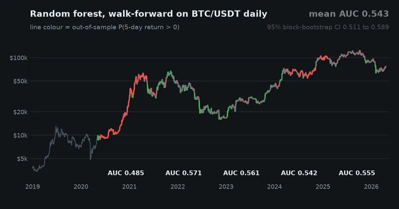
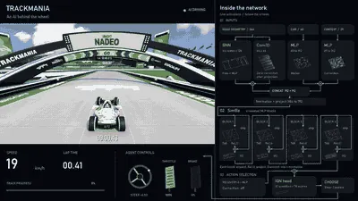

# Mateusz Jastrzębski

MSc student in Quantitative Finance at the University of Warsaw. Before that I did an engineering degree in computer science at PJATK and worked as a junior developer (Java/Spring, Python). These days I work on systematic strategies, machine learning on crypto data, and options and volatility.

### [btc-ml-pipeline](https://github.com/MateuszJastrzebski21/btc-ml-pipeline)

My engineering thesis: can classical ML predict the 5-day direction of BTC? Five expanding walk-forward folds, each model trained only on the past and scored on the next 436 days it never saw. Below is the random forest's real out-of-sample output, fold by fold. The tree models find a signal that survives a block bootstrap (CI above 0.5); turning it into a strategy that beats buy-and-hold after costs is the open problem.

<b>Results by model</b>

 

| Model | ROC-AUC, mean of 5 folds (95% CI) | Sharpe after 10 bps |
|---|---|---|
| Logistic regression | 0.528 (0.486 to 0.565) | 0.33 |
| Random forest | **0.543 (0.511 to 0.589)** | 0.24 |
| XGBoost | 0.539 (0.504 to 0.581) | 0.29 |
| Buy-and-hold | | 0.61 |

Daily Binance bars 2019 to 2026, leakage tests in CI, every number reproducible from a frozen data window. Full thesis (Polish) in the repo.

### [Implied-Volatility-Surface](https://github.com/MateuszJastrzebski21/Implied-Volatility-Surface)

SPY implied volatility surface from listed option chains, solving Black-Scholes for σ with Brent's method. Featured in a Coding Jesus video. Recorded from the app on 12 Nov 2026: the spike at short expiries and low strikes is the skew.

**[Open the live app](https://volatilitysurface.streamlit.app/)** and try another ticker.

### [TrackmaniaRL](https://github.com/TrackmaniaRL/TrackmaniaRL)

Open-source reinforcement learning library for Trackmania 2020. I contributed to it, including a fix for the training loop learning from stale rollouts. The clip is the trained agent driving, with the network's inputs and action choices on the right. More in the [r/reinforcementlearning launch post](https://www.reddit.com/r/reinforcementlearning/comments/1wc0a66/trackmaniarl_an_opensource_library_for_training/).

### [job-market-intelligence](https://github.com/MateuszJastrzebski21/job-market-intelligence)

Ingests job postings, extracts structured fields with Claude and scores every field against a hand-labelled set. I also rebuilt my retrieval layer in LangChain to see if it would do better:

| Retrieval | recall@5 | MRR | nDCG@5 |
|---|---|---|---|
| mine | 0.570 | 0.700 | 0.550 |
| mine + cross-encoder rerank | 0.608 | 0.878 | 0.632 |
| LangChain | 0.587 | 0.700 | 0.558 |
| LangChain + cross-encoder rerank | 0.608 | 0.906 | 0.642 |

No real difference between the two on 15 labelled queries; reranking is what moves the numbers.

[LinkedIn](https://www.linkedin.com/in/mateuszjastrzebski21/)
