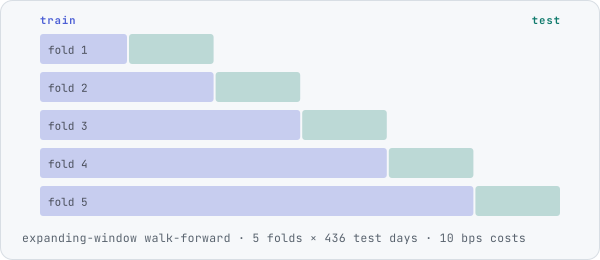
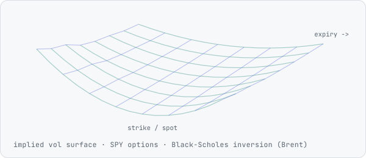
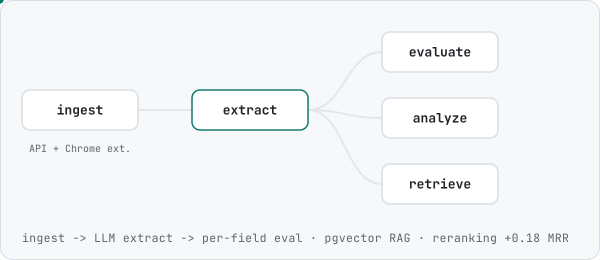
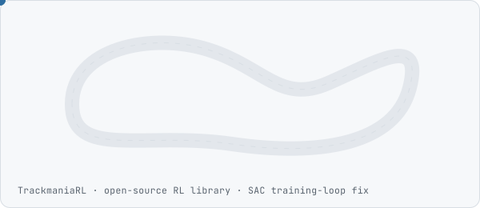

<picture>
  <source media="(prefers-color-scheme: dark)" srcset="assets/banner-dark.svg">
  
</picture>

MSc Quantitative Finance student at the University of Warsaw. Before that: a CS engineering degree at PJATK and work as a junior developer (Java/Spring, Python). I work on systematic strategies and machine learning for crypto markets, and on options and volatility.

<table>
<tr>
<td width="50%" valign="top">
<a href="https://github.com/MateuszJastrzebski21/btc-ml-pipeline"><picture><source media="(prefers-color-scheme: dark)" srcset="assets/btc-dark.svg"></picture></a>
<b><a href="https://github.com/MateuszJastrzebski21/btc-ml-pipeline">btc-ml-pipeline</a></b> 
Can classical ML time Bitcoin? Walk-forward study with block-bootstrap CIs, a cost-aware backtest and an audit of my own thesis results.
</td>
<td width="50%" valign="top">
<a href="https://github.com/MateuszJastrzebski21/Implied-Volatility-Surface"><picture><source media="(prefers-color-scheme: dark)" srcset="assets/ivs-dark.svg"></picture></a>
<b><a href="https://github.com/MateuszJastrzebski21/Implied-Volatility-Surface">Implied-Volatility-Surface</a></b> 
SPY implied volatility surface from listed option chains via Black-Scholes inversion, with a live Streamlit app.
</td>
</tr>
<tr>
<td width="50%" valign="top">
<a href="https://github.com/MateuszJastrzebski21/job-market-intelligence"><picture><source media="(prefers-color-scheme: dark)" srcset="assets/jmi-dark.svg"></picture></a>
<b><a href="https://github.com/MateuszJastrzebski21/job-market-intelligence">job-market-intelligence</a></b> 
LLM extraction pipeline with per-field evaluation and a RAG layer benchmarked against LangChain.
</td>
<td width="50%" valign="top">
<a href="https://github.com/TrackmaniaRL/TrackmaniaRL"><picture><source media="(prefers-color-scheme: dark)" srcset="assets/tm-dark.svg"></picture></a>
<b><a href="https://github.com/TrackmaniaRL/TrackmaniaRL">TrackmaniaRL</a></b> 
Contributor to an open-source RL library for Trackmania (training-loop fix for stale rollouts).
</td>
</tr>
</table>

[LinkedIn](https://www.linkedin.com/in/mateusz-jastrz%C4%99bski-8a2622264/)
