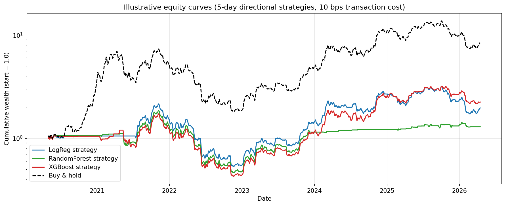
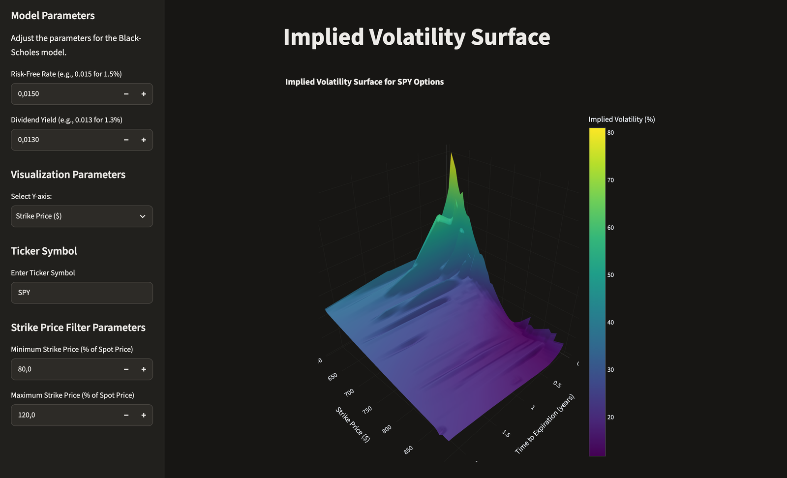

# Mateusz Jastrzębski

MSc student in Quantitative Finance at the University of Warsaw. Before that I did an engineering degree in computer science at PJATK and worked as a junior developer (Java/Spring, Python). These days I work on systematic strategies, machine learning on crypto data, and options and volatility.

### [btc-ml-pipeline](https://github.com/MateuszJastrzebski21/btc-ml-pipeline)

My engineering thesis: can logistic regression, random forest or XGBoost predict the 5-day direction of BTC under walk-forward validation? The tree models find a weak but real signal (out-of-sample AUC 0.54 to 0.55, bootstrap CI excludes 0.5), yet trading it long/flat earns a Sharpe of 0.24 to 0.33 after costs against 0.61 for buy-and-hold. Reproducible, with look-ahead tests in CI.

### [Implied-Volatility-Surface](https://github.com/MateuszJastrzebski21/Implied-Volatility-Surface)

SPY implied volatility surface from listed option chains, solving Black-Scholes for σ with Brent's method. Runs as a [Streamlit app](https://volatilitysurface.streamlit.app/) and was featured in a Coding Jesus video. Screenshot from 12 Nov 2026: the spike at short expiries and low strikes is the skew.

### [TrackmaniaRL](https://github.com/TrackmaniaRL/TrackmaniaRL)

Open-source reinforcement learning library for Trackmania 2020. I contributed to it, including a fix for the training loop learning from stale rollouts. The GIF is the trained agent driving, with the network's inputs and action choices on the right. More in the [r/reinforcementlearning launch post](https://www.reddit.com/r/reinforcementlearning/comments/1wc0a66/trackmaniarl_an_opensource_library_for_training/).

 

### [job-market-intelligence](https://github.com/MateuszJastrzebski21/job-market-intelligence)

Ingests job postings, extracts structured fields with Claude and scores every field against a hand-labelled set. I also benchmarked my own retrieval layer against a LangChain reimplementation: no measurable difference on 15 queries, while cross-encoder reranking added about 0.18 MRR.

[LinkedIn](https://www.linkedin.com/in/mateuszjastrzebski21/)
